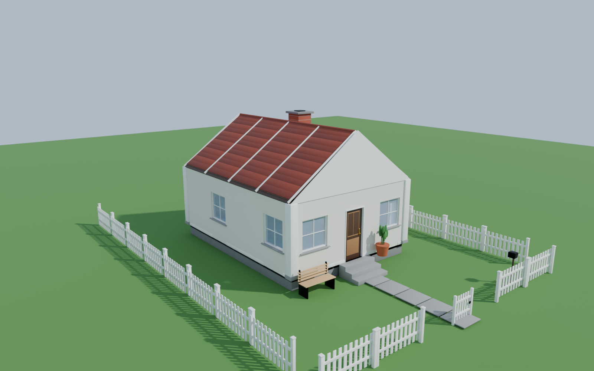
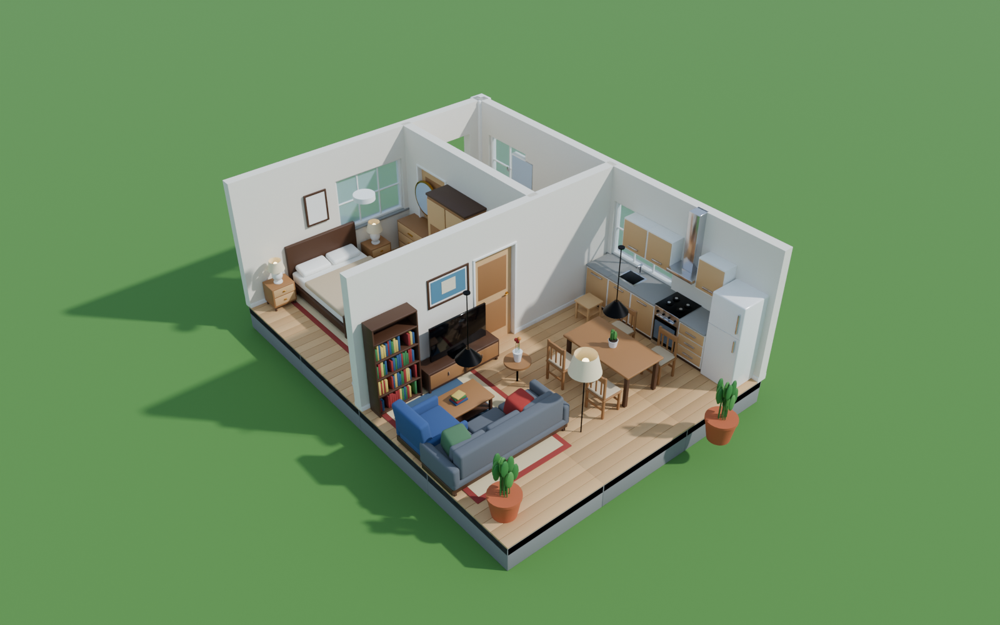

# Home Builder Kit — Pack d'assets 3D « Maison » (89 assets)

**Construisez une maison complète en quelques minutes.** Un kit modulaire de 89 assets low-poly propres : murs, sols, toits, escaliers, portes, fenêtres, plus tout le mobilier pour meubler chaque pièce.

## Ce que vous obtenez
- **89 assets** en 9 catégories (structure, sols & toits, portes & fenêtres, salon, chambre, cuisine, salle de bain, éclairage & déco, extérieur)
- **Système modulaire** sur grille de 2 m : les pièces s'assemblent sans trou ni réglage
- **Échelle réelle** (1 unité = 1 m), pivots au sol, orientation cohérente
- **Formats** : `.blend` (avec Asset Browser), `.fbx`, `.glb` — un fichier par asset
- **Maison de démonstration** modifiable (Showcase_House.blend)
- **Matériaux PBR unis**, UV prêts pour vos textures, aucun fichier externe
- **Léger** : ~900 triangles par asset en moyenne (81 000 pour tout le pack)
- **Usage commercial** inclus (voir licence)

## Idéal pour
Jeux vidéo (prototypage, level design, jeux de construction/décoration), visualisation d'architecture, animations, rendus, applications 3D/AR.

## Compatibilité
Blender 4.2+, Unity, Unreal Engine, Godot 4, tout logiciel compatible FBX / glTF.

## Contenu détaillé
Voir `ASSET_LIST.csv` (dimensions, nombre de triangles, matériaux de chaque asset) et les planches dans `Previews/Categories/`.
